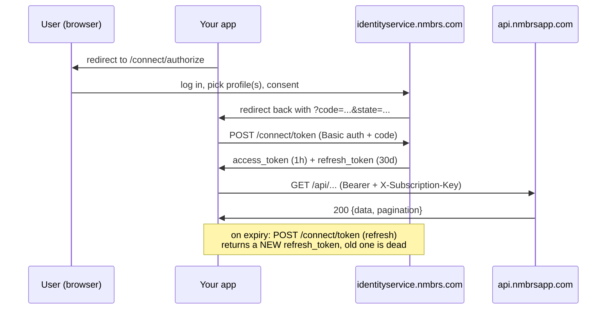
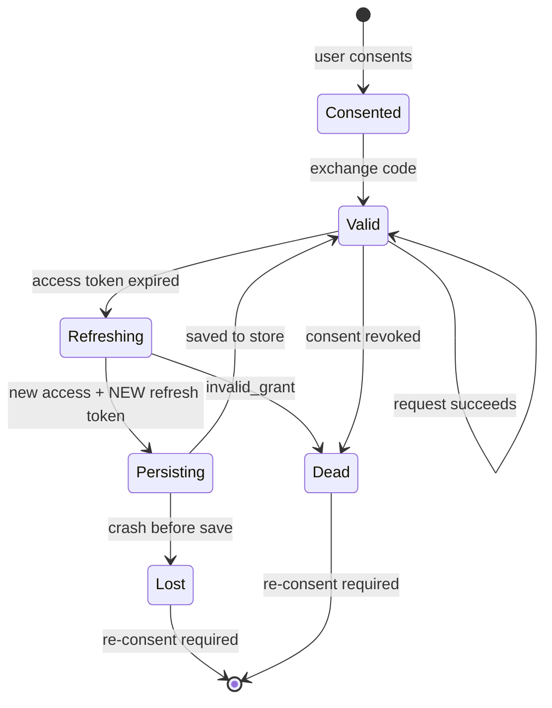

# Authentication

How the SDK authenticates against the Nmbrs REST API, and — the part that actually bites —
how to save tokens so your integration doesn't lock itself out.

> **Design stage.** This document specifies the authentication contract the implementation
> must meet. The code below is the intended API, not shipped behaviour.
> See [../DESIGN.md](../DESIGN.md) for the overall design and [errors.md](./errors.md) for
> the error reference.

## Read this first

Nmbrs refresh tokens are **single-use and rotating**. Every refresh returns a *new* refresh
token and invalidates the old one. Persist the new token before you use it, or you will
lose access and the end user will have to re-consent in a browser. Everything in
[Saving tokens](#saving-tokens) exists because of this one rule.

## What you need

Four credentials. Three come from OAuth, one does not.

| Credential | Where it comes from |
|---|---|
| `client_id` | [Developer Portal](https://developer.nmbrs.com/) → My Integrations |
| `client_secret` | Developer Portal → My Integrations (generate) |
| `redirect_uri` | Registered by you in the portal. Max **5** per client |
| `subscription_key` | Generated by [subscribing to a product](https://developer.nmbrs.com/products) |

The subscription key is **not** an OAuth credential. It is a separate, long-lived secret
sent as `X-Subscription-Key` on every API call, and it is not rotated by the OAuth flow.
Both headers are mandatory — a request missing either fails.

Use separate `client_id`s for development and production. Nmbrs expects this.

## How it works

Three-legged OAuth. Your application never sees the user's Nmbrs password; the user grants
you scoped, revocable access.

- **Resource owner** — the Nmbrs user, who consents.
- **Client** — your application.
- **Resource server** — the Nmbrs REST API at `api.nmbrsapp.com`.
- **Authorization server** — `identityservice.nmbrs.com`.

Only **client logins and company logins** appear in the consent picker; that is by design,
since consent must be tied to an accountable user with a bounded data scope. One email
address holding client logins for several debtors can consent for all of them at once.



## Endpoints

| Purpose | URL |
|---|---|
| Discovery | `https://identityservice.nmbrs.com/.well-known/openid-configuration` |
| Authorize | `https://identityservice.nmbrs.com/connect/authorize` |
| PAR | `https://identityservice.nmbrs.com/connect/par` |
| Token | `https://identityservice.nmbrs.com/connect/token` |
| Revocation | `https://identityservice.nmbrs.com/connect/revocation` |
| Introspection | `https://identityservice.nmbrs.com/connect/introspect` |
| API base | `https://api.nmbrsapp.com` |

## Quickstart

```python
from nmbrs_rest import Nmbrs
from nmbrs_rest.auth import OAuth
from nmbrs_rest.tokens import FileTokenStore

oauth = OAuth(
    client_id="...",
    client_secret="...",
    redirect_uri="https://yourapp.example/callback",
)

# 1. Send the user here. Keep `request` in the session - you need it in step 2.
request = oauth.authorization_url(
    scopes=["company.info.read", "employee.info.read", "offline_access"],
)
redirect_to(request.url)

# 2. In your callback handler. Passing both states performs the CSRF check.
token = oauth.exchange_code(
    code,
    returned_state=callback_state,
    expected_state=request.state,
    code_verifier=request.code_verifier,   # None unless pkce=True
)

# 3. Persist it, then use it. The store is what keeps you alive across restarts.
store = FileTokenStore("~/.config/nmbrs/tokens.json")
store.save("acme-nl", token)

api = Nmbrs(
    subscription_key="...",
    oauth=oauth,
    token_store=store,
    token_key="acme-nl",
)

for company in api.companies():
    print(company.name)
```

After the first authorization you never touch the browser flow again — the SDK refreshes
and re-persists automatically.

## The authorization flow

### 1. Send the user to consent

```
GET https://identityservice.nmbrs.com/connect/authorize
  ?client_id={client_id}
  &redirect_uri={redirect_uri}
  &response_type=code
  &scope=company.info.read%20employee.info.read%20offline_access
  &state={random}
```

Scopes are **space-separated** (URL-encoded as `%20` or `+`).

`state` is mandatory in practice: it is your CSRF defence. Generate it per request, store
it in the session, and reject the callback if it does not match.

```python
import secrets
state = secrets.token_urlsafe(32)
```

The user is redirected back as:

```
https://yourapp.example/callback?code=3049C9...&scope=company.info.read%20...&state=...
```

The `code` is valid for **5 minutes** and single-use. Exchange it immediately; do not
persist it.

Note the redirect returns **granted** scope, which may be narrower than what you asked
for. See [Requested vs granted scope](#requested-vs-granted-scope).

For local testing, `http://localhost:8080` is an acceptable `redirect_uri`.

### 2. Exchange the code for tokens

```http
POST /connect/token HTTP/1.1
Host: identityservice.nmbrs.com
Authorization: Basic {basicAuth}
Content-Type: application/x-www-form-urlencoded

grant_type=authorization_code&code={code}&redirect_uri={redirect_uri}
```

```json
{
  "access_token": "eyJhbGci...",
  "expires_in": 3600,
  "token_type": "Bearer",
  "refresh_token": "A1B2C3...",
  "scope": "company.info.read employee.info.read offline_access"
}
```

You only get `refresh_token` if you requested `offline_access`. Forget it and your
integration dies after one hour with no way back except another browser round-trip.

#### The Basic auth footgun

Per [RFC 6749 §2.3.1](https://datatracker.ietf.org/doc/html/rfc6749#section-2.3.1), both
halves must be **URL-encoded before** being joined and base64-encoded. Nmbrs credentials
routinely contain characters this matters for — their own example `client_id` is
`7xr7NV9yqcUz*r2C$ey6`.

```python
import base64
from urllib.parse import quote


def basic_auth_header(client_id: str, client_secret: str) -> str:
    """RFC 6749 §2.3.1: percent-encode each half, THEN join and base64."""
    encoded = f"{quote(client_id, safe='')}:{quote(client_secret, safe='')}"
    return "Basic " + base64.b64encode(encoded.encode()).decode()
```

The version everyone writes first, which works right up until a secret contains a reserved
character and then fails with `invalid_client`:

```python
# WRONG - no percent-encoding
raw = f"{client_id}:{client_secret}"
header = "Basic " + base64.b64encode(raw.encode()).decode()
```

The discovery document also advertises `client_secret_post`, so credentials in the form
body are accepted as an alternative. *(Source: OIDC discovery
`token_endpoint_auth_methods_supported`, not the written Nmbrs docs.)*

### 3. Call the API

```http
GET /api/companies?pageNumber=1&pageSize=100 HTTP/1.1
Host: api.nmbrsapp.com
Authorization: Bearer {access_token}
X-Subscription-Key: {subscription_key}
Accept: application/json
```

### PAR (optional)

Pushed Authorization Requests replace **step 1 only**. You POST the parameters over a
back channel and get a short reference to redirect with, so `scope` and friends never
appear in a browser-visible URL.

```http
POST /connect/par HTTP/1.1
Host: identityservice.nmbrs.com
Authorization: Basic {basicAuth}
Content-Type: application/x-www-form-urlencoded

client_id={id}&state={state}&scope={scopes}&response_type=code&redirect_uri={uri}
```

```json
{ "request_uri": "urn:ietf:params:oauth:request_uri:C51016...", "expires_in": 600 }
```

Then redirect with only two parameters:

```
GET /connect/authorize?client_id={id}&request_uri={request_uri}
```

The `request_uri` is valid **600 seconds**, single-use, and bound to the `client_id` that
requested it. Steps 2–4 are identical either way.

Worth using when you request many scopes (long query strings get truncated by some proxies)
or when you want authorization parameters off the browser URL entirely.

```python
request = oauth.authorization_url(scopes=[...], par=True)
```

### PKCE

The identity server advertises `code_challenge_methods_supported: ["plain", "S256"]`.

> **Caveat:** this comes from the live OIDC discovery document, **not** from Nmbrs'
> written documentation, which never mentions PKCE. Verify it against your own client
> before depending on it.

PKCE binds the authorization code to the client that requested it, so a stolen code is
useless. Recommended for any public or mobile client, harmless for confidential ones.

```python
import base64
import hashlib
import secrets

verifier = secrets.token_urlsafe(64)[:128]           # 43-128 chars
challenge = base64.urlsafe_b64encode(
    hashlib.sha256(verifier.encode()).digest()
).decode().rstrip("=")
```

Send `code_challenge={challenge}&code_challenge_method=S256` on the authorize request, and
`code_verifier={verifier}` on the token exchange. Never use `plain`.

```python
request = oauth.authorization_url(scopes=[...], pkce=True)
# request.code_verifier must be carried to exchange_code()
```

### Requested vs granted scope

The user may consent to a subset of what you asked for. Both the redirect and the token
response return the **granted** scope.

Record what was granted, not what you requested. The SDK stores granted scopes on the
`Token` and uses them to explain 403s precisely — see
[scope-aware diagnosis](./errors.md#scope-aware-403-diagnosis).

## Token lifetimes

| Token | Lifetime | Reusable? |
|---|---|---|
| `authorization_code` | 5 minutes | No, single use |
| `access_token` | 1 hour | Yes, until expiry |
| `refresh_token` | 30 days | **No — single use, rotates on every refresh** |



The `Lost` path is the one that hurts, and it is entirely preventable.

## Saving tokens

### What to persist

| Field | Type | Why |
|---|---|---|
| `access_token` | `str` | Avoids a refresh on every process start |
| `refresh_token` | `str` | **Critical.** Losing this means re-consent |
| `expires_at` | `datetime` (UTC) | Absolute, not the relative `expires_in` |
| `scopes` | `tuple[str, ...]` | Granted scopes, for 403 diagnosis |
| `token_type` | `str` | Always `Bearer` today |
| `obtained_at` | `datetime` (UTC) | Diagnostics; refresh-token age |

Never persist `client_secret` or `subscription_key` in the token store. Those are
application config, not per-user state, and they belong in your secret manager.

Store `expires_at` as an absolute UTC instant. Persisting `expires_in` and recomputing on
load silently extends the lifetime by however long the process was down.

### The TokenStore protocol

```python
from typing import Protocol


class TokenStore(Protocol):
    """Durable storage for OAuth tokens, keyed per consented profile."""

    def load(self, key: str) -> Token | None:
        """Return the stored token, or None if absent."""

    def save(self, key: str, token: Token) -> None:
        """Durably persist. MUST NOT return until the write is committed."""

    def delete(self, key: str) -> None:
        """Remove the token. Used on revocation."""
```

`save()` returning before the write is durable is the single most dangerous thing an
implementation can do. The SDK calls `save()` *before* using a rotated refresh token, and
relies on that ordering.

### Built-in stores

| Store | Durable | Encrypted | Use when |
|---|---|---|---|
| `MemoryTokenStore` | No | n/a | Tests, short scripts |
| `FileTokenStore` | Yes | No | **Default.** Single host, single process |
| `KeyringTokenStore` | Yes | Yes (OS) | Desktop and developer machines |
| `CallbackTokenStore` | Yours | Yours | Database, Vault, AWS Secrets Manager |

**Recommended default: `FileTokenStore`.** It is durable, atomic, cross-process safe, and
has no dependencies. Move to `CallbackTokenStore` when you outgrow a single host.

```python
from nmbrs_rest.tokens import FileTokenStore

store = FileTokenStore("~/.config/nmbrs/tokens.json")   # 0600 on POSIX
```

Its `save()` is atomic — write to a temp file in the same directory, `os.replace()` into
position — so a crash mid-write leaves the previous good token intact rather than a
truncated file.

```python
import json
import os
import tempfile
from pathlib import Path


def _atomic_write(path: Path, payload: dict[str, object]) -> None:
    path.parent.mkdir(parents=True, exist_ok=True)
    fd, tmp = tempfile.mkstemp(dir=path.parent, suffix=".tmp")
    try:
        with os.fdopen(fd, "w", encoding="utf-8") as fh:
            json.dump(payload, fh)
            fh.flush()
            os.fsync(fh.fileno())      # durable before the rename
        os.replace(tmp, path)          # atomic on POSIX and Windows
    except BaseException:
        Path(tmp).unlink(missing_ok=True)
        raise
```

`FileTokenStore` does **not** encrypt. It sets `0600` so other users on the box cannot read
it; it does nothing against a stolen disk, a backup, or a compromised host. See
[SECURITY.md](../SECURITY.md).

For anything else, implement the protocol:

```python
class VaultTokenStore:
    def __init__(self, client: VaultClient) -> None:
        self._client = client

    def load(self, key: str) -> Token | None:
        raw = self._client.read(f"nmbrs/{key}")
        return Token.model_validate(raw) if raw else None

    def save(self, key: str, token: Token) -> None:
        self._client.write(f"nmbrs/{key}", token.model_dump(mode="json"))

    def delete(self, key: str) -> None:
        self._client.delete(f"nmbrs/{key}")
```

## Keeping tokens alive

### The refresh algorithm

The SDK refreshes **proactively**, before expiry, and also **reactively** on a 401 as a
safety net.

1. Before each request, if `expires_at - skew <= now`, refresh first.
2. Send the request.
3. On `401`, refresh **once** and replay the original request. Never loop — a second 401
   after a successful refresh means something else is wrong, and retrying burns tokens.

Default skew is 60 seconds, covering a slow request plus mild clock drift.

```python
REFRESH_SKEW = timedelta(seconds=60)

def _needs_refresh(token: Token) -> bool:
    return token.expires_at - REFRESH_SKEW <= datetime.now(tz=timezone.utc)
```

Compute expiry in UTC, always. A local clock that is wrong by more than an hour causes
either constant refreshing or constant 401s; the reactive path covers the latter.

### The persist-before-use rule

```
refresh -> receive new tokens -> store.save() -> ONLY THEN use them
```

If the process dies after `save()`, the next start reads a valid token. If it dies before,
the old refresh token is still the one on disk — and it has already been consumed by the
server, so that path is dead. This ordering is not optional.

## Concurrency and crash safety

Because refresh tokens are single-use, two concurrent refreshes are a genuine bug: one
wins, the other gets `invalid_grant`, and if the loser overwrites the store with its
failed state you have lost the working token too.

### Threads

An in-process lock, with a double-check so waiters don't refresh again after the winner
already did:

```python
import threading


class _Refresher:
    def __init__(self, store: TokenStore, oauth: OAuth, key: str) -> None:
        self._lock = threading.Lock()
        self._store, self._oauth, self._key = store, oauth, key

    def ensure_fresh(self, token: Token) -> Token:
        if not _needs_refresh(token):
            return token
        with self._lock:
            current = self._store.load(self._key) or token
            if not _needs_refresh(current):
                return current                     # another thread already did it
            new = self._oauth.refresh(current.refresh_token)
            self._store.save(self._key, new)       # persist BEFORE returning
            return new
```

### Processes and workers

A thread lock is useless across processes. `FileTokenStore` therefore takes an **advisory
file lock** (`msvcrt.locking` on Windows, `fcntl.flock` on POSIX) around the
read-refresh-write cycle, so a Gunicorn worker pool sharing one token file is safe.

For a distributed deployment there is no shared filesystem, so the store must provide the
mutual exclusion — a row lock, a compare-and-swap on a version column, or a short-lived
distributed lock. The SDK exposes the recovery path either way:

```python
try:
    new = oauth.refresh(current.refresh_token)
except InvalidGrantError:
    # Someone else rotated it between our load and our refresh.
    refreshed = store.load(key)
    if refreshed and refreshed.refresh_token != current.refresh_token:
        return refreshed          # reload and carry on
    raise ReauthorizationRequired(...) from None
```

That distinction matters: `invalid_grant` *with* a newer token in the store is a benign
race, and `invalid_grant` *without* one is a genuine dead end requiring re-consent.

### Rules of thumb

- One token store instance per process; do not copy `Token` objects between threads.
- Never run two refreshes for the same `token_key` concurrently.
- Never let a failed refresh overwrite a good stored token.

## Multi-tenant token management

One `client_id` serves all your customers, and one user can consent for several debtors.
Tokens are per consented profile, so you hold many.

Key them by something stable and meaningful to *you* — your own tenant identifier, not
something derived from the token:

```python
store = FileTokenStore("~/.config/nmbrs/tokens.json")

api_acme = Nmbrs(subscription_key=KEY, oauth=oauth, token_store=store, token_key="acme-nl")
api_globex = Nmbrs(subscription_key=KEY, oauth=oauth, token_store=store, token_key="globex")
```

A token's reach is decided at consent, not by you: it sees the debtors the consenting login
covers and the scopes granted. Using a token against a company belonging to a different
debtor returns **403 / 40303 or 40305**, which is the most common source of confusion in
multi-tenant setups. See [the three 403s](./errors.md#the-three-403s).

The subscription key is per *application*, not per tenant — the same key is used for all of
them.

## Recovery

| What happened | How you find out | What to do |
|---|---|---|
| Access token expired | 401 / `40102` | Nothing — the SDK refreshes and replays |
| Refresh token expired (30 days idle) | `invalid_grant` from `/connect/token` | Re-consent. Unavoidable |
| Refresh token already used (race) | `invalid_grant` | Reload from store; if a newer token is there, use it. Otherwise re-consent |
| Consent revoked in App Manager | `invalid_grant` on refresh, or 401 on API | Re-consent. Notify the customer — they did this deliberately |
| Client secret rotated | `invalid_client` | Update config. Existing refresh tokens still work with the new secret |
| No refresh token at all | `token.refresh_token is None` | You omitted `offline_access`. Re-consent with it |
| Token file lost or corrupted | `TokenStoreError` on load | Re-consent. There is no recovery from a lost refresh token |

The SDK surfaces the terminal cases as `ReauthorizationRequired`, which carries the
`token_key` so a multi-tenant app knows *which* customer must reconnect:

```python
from nmbrs_rest.errors import ReauthorizationRequired

try:
    for company in api.companies():
        ...
except ReauthorizationRequired as exc:
    notify_customer(exc.token_key, oauth.authorization_url(scopes=SCOPES)[0])
```

Refresh tokens expire after **30 days of not being used**. An integration that runs
monthly is at real risk; refresh on a schedule rather than only on demand.

## Revocation and disconnect

When a customer disconnects, revoke rather than just deleting your copy:

```python
oauth.revoke(token.refresh_token, token_type_hint="refresh_token")
store.delete("acme-nl")
```

Revoking the refresh token invalidates the grant. Deleting your local copy alone leaves a
live credential outstanding for up to 30 days.

Users can also revoke from the App Manager inside their Nmbrs environment, without telling
you. Handle `ReauthorizationRequired` on every code path that touches the API.

The identity server also exposes `/connect/introspect` for checking whether a token is
still active. *(Source: OIDC discovery.)*

## Scopes

29 scopes exist; **24 guard REST operations**. Either the write scope or its `.read`
counterpart satisfies a read operation, so `employee.info` also grants everything
`employee.info.read` does.

| Scope | Ops | Covers |
|---|---:|---|
| `employee.payment` | 20 | Hour/wage components, cost centers, days worked |
| `employee.info` | 17 | Personal info, address, family, extra fields, org data |
| `company.payrollsettings.read` | 16 | Payroll runs, journals, hour codes, salary tables, pension export |
| `employee.employment` | 15 | Contracts, employments, salary, schedule |
| `employee.info.read` | 11 | Read-only of `employee.info` |
| `company.document.read` | 9 | Payroll run and wage tax documents, SEPA, XML |
| `employee.leave` | 9 | Absence and leave |
| `company.info` | 8 | Company, addresses, bank accounts, contacts, debtor info |
| `company.info.read` | 8 | Read-only of `company.info` |
| `employee.orgstructure` | 8 | Departments, functions, managers, user accounts |
| `employee.payment.read` | 7 | Read-only of `employee.payment` |
| `employee.employment.read` | 6 | Read-only of `employee.employment` |
| `employee.payrollsettings` | 6 | SVW, wage tax settings, labour agreement, lease cars |
| `employee.document` | 5 | Employee documents, upload |
| `employee.orgstructure.read` | 5 | Read-only of `employee.orgstructure` |
| `employee.document.read` | 4 | Read-only of `employee.document` |
| `employee.leave.read` | 4 | Read-only of `employee.leave` |
| `employee.payrollsettings.read` | 4 | Read-only of `employee.payrollsettings` |
| `debtor.info.read` | 3 | Debtors, tags, accountant contact |
| `employee.bankaccount` | 3 | Employee bank accounts |
| `user.info.read` | 2 | Authenticated user info, subscription info |
| `company.leave.read` | 1 | Company leave groups |
| `document.read` | 1 | Document content by task id |
| `employee.bankaccount.read` | 1 | Read-only of `employee.bankaccount` |

Plus `offline_access` — guards nothing, but **required for a refresh token**.

Advertised by the identity server but unused by any REST operation: `openid`, `profile`,
`nmbrs`, `company.payrollsettings`.

Two read endpoints accept **only** a write scope, with no `.read` alternative:

| Endpoint | Requires |
|---|---|
| `GET /api/companies/{companyId}/defaultTemplates` | `employee.info` |
| `GET /api/countries` | `employee.info` |

### Choosing scopes

Ask for the minimum. Adding a scope later means putting every existing customer through
consent again, so think it through once — but do not over-request "just in case", because
a broad consent screen costs you conversions and the scopes are visible to the user.

Use `.read` variants wherever you only read. A read-only integration should never request
`employee.payment` when `employee.payment.read` will do.

Always include `offline_access` unless you genuinely want a one-hour session.

## Security checklist

- [ ] `client_secret` and `subscription_key` come from a secret manager, not source control
- [ ] Token store files are in `.gitignore` and outside any build context
- [ ] Separate `client_id` for development and production
- [ ] Minimum scopes; `.read` variants where possible
- [ ] Tokens never logged — check your HTTP debug logging, which loves dumping headers
- [ ] `state` validated on every callback
- [ ] `redirect_uri` is HTTPS in production
- [ ] Revocation on customer disconnect, not just local deletion
- [ ] Refresh on a schedule if the integration runs less often than every 30 days

The SDK redacts tokens in exception messages and `repr()`. It cannot redact them from
`httpx` debug logging you enable yourself.

## Identity-server errors

These come from `identityservice.nmbrs.com` and use the **OAuth 2.0 / RFC 6749** format —
completely different from the RFC 7807 errors the API returns. If you are debugging a
response with a `detail` and a numeric `code`, you are in the wrong document: see
[errors.md](./errors.md).

```json
{ "error": "invalid_grant", "error_description": "..." }
```

| `error` | In Nmbrs terms | Fix |
|---|---|---|
| `invalid_grant` | Refresh token expired, already used, or consent revoked. Also an expired or reused authorization code | Re-consent. First check whether another worker already rotated it |
| `invalid_client` | Wrong `client_id`/`client_secret`, or the Basic header was not percent-encoded per RFC 6749 §2.3.1 | Check credentials, then check your encoding |
| `invalid_scope` | Requested a scope that does not exist or is not enabled for your client | Check spelling against the [scopes table](#scopes) |
| `invalid_request` | Missing or malformed parameter, or a bad/expired `request_uri` on PAR | Compare against the request shapes above |
| `unauthorized_client` | Client not permitted to use this grant type | Nmbrs supports authorization code only — do not use `client_credentials` |
| `access_denied` | User declined consent, or closed the consent screen | Nothing to fix; surface it and let them retry |
| `server_error` / `temporarily_unavailable` | Identity server problem | Retry with backoff |

The discovery document advertises grant types including `client_credentials` and
`password`, because the identity server is shared across Nmbrs products. **The public REST
API supports the authorization code flow only** — Nmbrs' documentation states it is "the
only mean of authentication offered". Do not build against the others.

The SDK maps these to `IdentityServerError` and its subclasses, distinct from the API
error hierarchy so you can tell at a glance which system rejected you.
